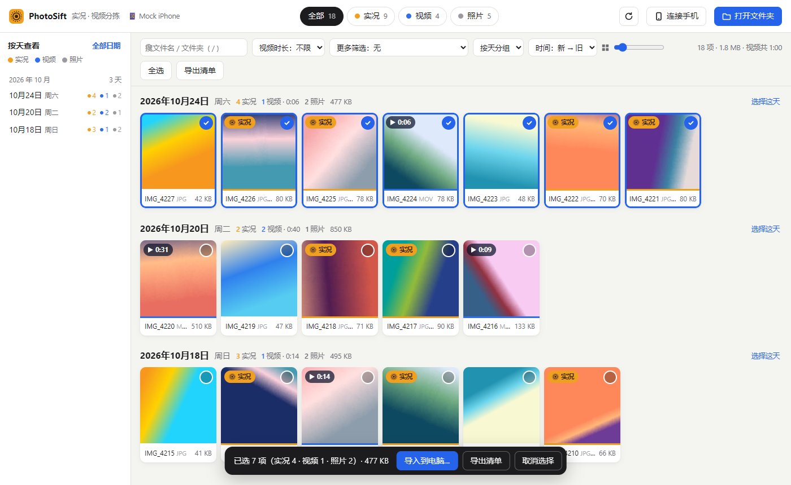

# PhotoSift

在 Windows 上用数据线**直接读取 iPhone / 安卓手机**里的照片和视频，自动分出**实况**、**视频**和照片，按拍摄日期分组浏览，挑好了再导入电脑。不需要先把整个 DCIM 文件夹拷到电脑上。



<sub>截图使用的是演示数据。</sub>

[English](#english)

## 功能

- **直接读手机**：USB 连接后点「连接手机」，几秒就能看到所有照片和视频。只读打开，不会修改或删除手机上的任何文件。
- **分出实况、视频、照片**
  - **实况**：同名的照片和短视频（如 `IMG_1234.HEIC` + `IMG_1234.MOV`）会配成一对。改过文件名的，靠 Apple 写入的实况标识也能配上。
  - **安卓动态照片**：内嵌视频的 JPG 也能认出来。
  - **视频**：显示时长，可以按时长筛选。
- **按拍摄日期浏览**：用照片和视频里记录的拍摄时间，不是文件复制时间。可以按天或按月分组；左侧日期列表按住 Ctrl 或 Shift 可以多选几天。
- **筛选**
  - 视频时长
  - 缺照片的实况视频
  - 截屏和录屏
  - 没有拍摄时间的文件
  - 还没导入电脑的 / 已经导入过的
- **导入到电脑**
  - 子文件夹可以按日期、按类型，或「日期 \ 类型」来建。
  - 实况可以只要照片，或者只要视频。
  - 导入的文件，创建时间和修改时间都设成拍摄时间。
  - 已经导入过的会自动跳过，重名的自动改名，导入前会检查磁盘空间。
- **导出清单**：把当前列表导出成 Excel 能打开的 CSV。
- **也能打开电脑上的文件夹**：直接用浏览器打开 `PhotoSift.html`，就能浏览已经拷到电脑上的照片和视频，这时不需要助手。
- **快捷键**

  | 按键 | 作用 |
  |---|---|
  | `1` / `2` / `3` / `4` | 全部 / 实况 / 视频 / 照片 |
  | `/` | 搜索 |
  | `Ctrl+A` | 全选 |
  | `Esc` | 取消选择 |

## 使用方法

**需要：**
- Windows 10 或 11。系统自带的 .NET Framework 4 就够了，不用另外安装任何东西。
- 最新版 Chrome 或 Edge。

1. **下载**：在本页点 **Code → Download ZIP**，或者在 [Releases](https://github.com/Juice-zhi/PhotoSift/releases) 里下载，然后解压到任意文件夹。
2. **设置 iPhone（推荐）**：打开 **设置 → 照片 → 传输到 Mac 或 PC**，选「**保留原片**」。这样不用转格式，读取更快，实况的配对信息也更完整。
3. **连接手机**：用数据线连上电脑，然后**解锁手机**。iPhone 第一次连接会问要不要信任这台电脑，点「信任」；安卓手机把 USB 用途改成「传输文件」。
4. **启动**：双击 **`启动 PhotoSift.cmd`**。
   - 第一次运行时，会用 Windows 自带的 C# 编译器生成 `PhotoSift.exe`，几秒钟就好。
   - 之后会出现一个小黑窗口，这是助手，用的时候别关。浏览器会自动打开 PhotoSift。
5. **读取**：点「**连接手机**」。
6. **导入**：勾选想要的，点「**导入到电脑…**」，再选保存位置。

> **Windows 提示「已保护你的电脑」？** 点「更多信息 → 仍要运行」。也可以在解压之前，右键 ZIP → 属性 → 勾选「解除锁定」。
>
> **找不到手机？** 先看「此电脑」里能不能看到手机，比如 Apple iPhone → Internal Storage。能看到，PhotoSift 就能读。看不到的话，可以安装 Microsoft Store 里的 Apple Devices 应用（或者 iTunes）来获得 iPhone 驱动，然后重新插拔手机。

## 工作原理和隐私

| 文件 | 作用 |
|---|---|
| `启动 PhotoSift.cmd` | 第一次运行时编译助手，然后启动它 |
| `PhotoSift.html` | 界面，所有分类和解析都在浏览器里本地完成 |
| `PhotoSift-helper/Server.cs` | 本地助手，单个 C# 文件，没有第三方依赖 |

- **助手**通过 Windows Portable Devices（WPD）以**只读**方式访问手机。它只监听本机的 `localhost`，每次启动生成一个随机令牌，别的网页访问不了它。
- **界面**直接解析 HEIC、JPG、MOV、MP4 里的元数据（EXIF、QuickTime、Apple 实况标识），用来分类和取拍摄时间。
- **照片和视频不会上传到任何地方。** 唯一的联网请求是：浏览器不能直接显示 HEIC 时，会从 jsDelivr 加载开源解码库 [heic-to](https://www.npmjs.com/package/heic-to)。这个请求只下载解码代码，不会上传任何内容。

## 从源码构建

`启动 PhotoSift.cmd` 实际执行的就是下面这条命令。改了 `Server.cs` 之后，删掉 `PhotoSift-helper\PhotoSift.exe`，再双击启动，就会重新编译。

```bat
%WINDIR%\Microsoft.NET\Framework64\v4.0.30319\csc.exe /nologo /codepage:65001 /optimize /target:exe /out:PhotoSift.exe /r:System.Web.Extensions.dll /r:System.Windows.Forms.dll /r:System.Drawing.dll Server.cs
```

助手的命令行参数：

| 参数 | 作用 |
|---|---|
| `--port N` | 指定端口，默认 47819 |
| `--no-browser` | 启动后不自动打开浏览器 |
| `--mock <文件夹>` | 把一个本地文件夹当成手机，用来测试 |

## 状态

PhotoSift 已经在模拟手机和真实 WPD 设备上测试过，还需要更多真 iPhone 和安卓手机的测试。

已知限制：iPhone 一次只能传一个文件，也不支持从文件中间开始读。所以：
- 超过 64 MB 的视频不能在导入前预览，导入到电脑后再播放就行。
- 后台读取拍摄时间和缩略图时，要把整个文件传一遍，照片很多时会比较慢。

遇到分类不对、读不到或报错的情况，欢迎提 [Issue](https://github.com/Juice-zhi/PhotoSift/issues)，最好附上手机型号和系统版本。

## License

[MIT](LICENSE)

---

## English

**PhotoSift** is a Windows tool for browsing an iPhone or Android phone directly over USB, without copying DCIM to the PC first.

- **Sorting:** it separates **Live Photos**, **videos** and stills, and groups them by capture date.
- **Filters:** video duration, orphan Live clips, screenshots, missing capture time, and already imported or not.
- **Import:** copies what you pick to the PC, preserving capture dates and skipping files you already imported.

To use it:
1. Download and extract the ZIP.
2. Connect and unlock the phone (tap **Trust** on iPhone).
3. Double-click `启动 PhotoSift.cmd` ("Start PhotoSift"). On first run it compiles a small helper with the C# compiler built into Windows. The helper reads the phone read-only through Windows Portable Devices and serves the UI on `localhost` only.
4. Click **连接手机** ("Connect phone").

Files never leave your computer. The only network request is loading the open-source HEIC decoder from jsDelivr when the browser can't display HEIC by itself. Requirements: Windows 10/11 and a recent Chrome or Edge. MIT licensed.
